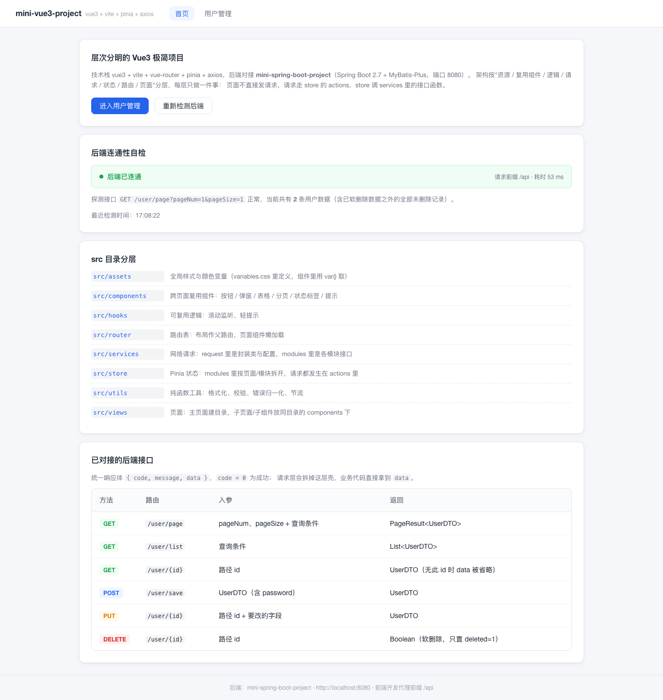
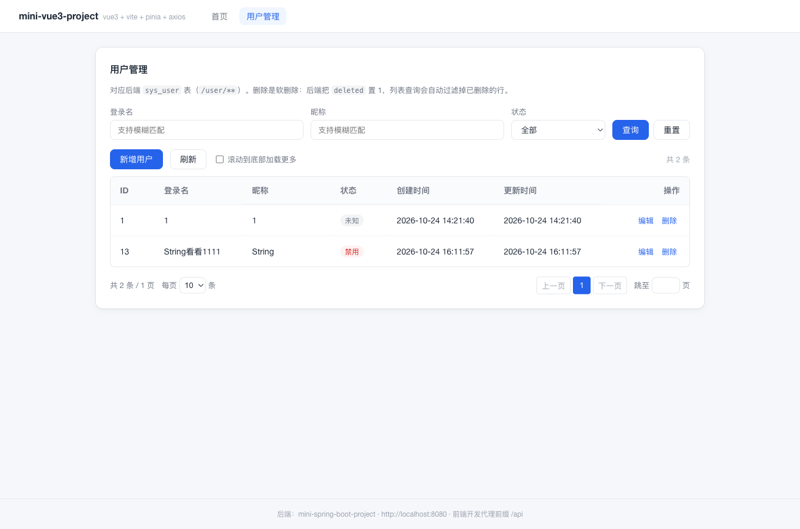
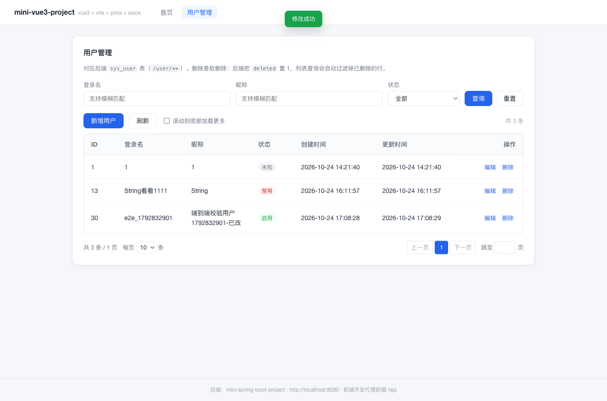
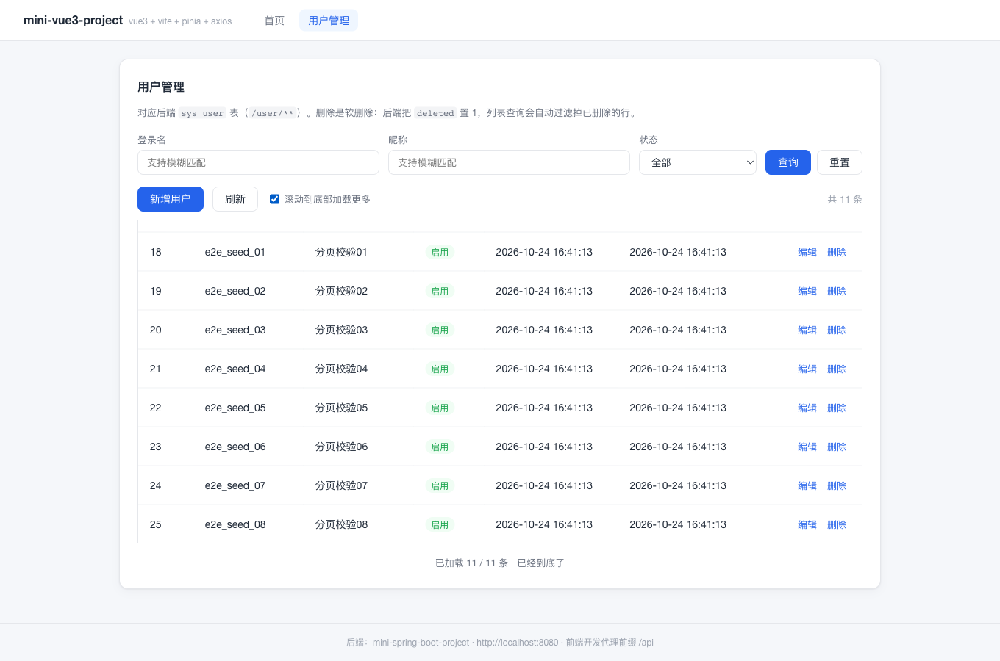

# mini-vue3-project

层次分明的 Vue3 极简项目，架构参考掘金文章 [《项目篇: 思路清晰的 Vue3 项目架构设计及复盘》](https://juejin.cn/post/7227401803724767293)：
按 **资源 / 复用组件 / 逻辑(hooks) / 请求 / 状态 / 路由 / 页面** 分层，每层只做一件事。

后端对接同目录下的 **mini-spring-boot-project**（Spring Boot 2.7 + MyBatis-Plus + MySQL，默认 `http://localhost:8080`）。

技术栈：`vue 3` + `vite` + `vue-router 4` + `pinia` + `axios`（不引 UI 组件库，样式用原生 CSS + 全局变量，保持"极简"）。

---

## 一、快速开始

### 1. 先起后端（mini-spring-boot-project）

```bash
cd ../mini-spring-boot-project
./mvnw spring-boot:run        # 需要本地 MySQL，默认 root/root，库名 mini_spring_boot
```

后端起来后，`http://localhost:8080/user/page?pageNum=1&pageSize=1` 应该返回 `{"code":0,...}`。

### 2. 再起前端

```bash
npm install
npm run dev                   # http://localhost:5300
```

打开首页会看到「后端连通性自检」卡片：连上了会显示用户总数与探测耗时，没连上会给出具体原因和启动命令。

```bash
npm run build                 # 产物在 dist/
npm run preview               # 预览构建产物：http://localhost:5301
```

端口对照表（**别走错端口，走错就是 404**）：

| 端口 | 是什么 | 怎么起 |
| --- | --- | --- |
| `5300` | 开发服务器（带 HMR），日常开发用这个 | `npm run dev` |
| `5301` | 预览服务器（跑 `dist/` 里的构建产物，**不是**开发服务器） | `npm run preview` |
| `8080` | 后端 mini-spring-boot-project（纯 API，根路径 `/` 返回 404 是正常的） | `./mvnw spring-boot:run` |

> **为什么不用 Vite 默认的 5173/5174**：本机 517x 这段被其他工具占用（是一个 Vite 实例，但它不是这个项目的，
> 它的 root 里没有 `index.html`、也没加载本项目的 `vite.config.js`，所以访问 `/` 只会得到一个空 body 的 404）。
> 用默认端口时很容易出现"打开 5173 是 404，其实服务在别的端口"。要换端口用环境变量：
>
> ```bash
> DEV_PORT=5300 PREVIEW_PORT=5301 npm run dev
> ```
>
> 判断某个端口上到底是谁：`curl -i http://localhost:5300/` —— 返回 200 才是本项目（`Content-Type: text/html`）。

> 另外：Vite 的 `preview` **不继承** `server.proxy`，所以 `vite.config.js` 里把代理抽成了 `apiProxy`，
> `server` 和 `preview` 都挂了一遍。只配 `server.proxy` 时，`npm run preview` 页面能打开、`/api/**` 却会 404。

> 如果 `npm install` 报 `EPERM ... ~/.npm/_cacache`，说明 npm 全局缓存目录权限有问题，
> 可以用本地缓存绕开：`npm install --cache ./.npm-cache`。

---

## 二、目录结构（分层）

```text
mini-vue3-project
├── index.html
├── vite.config.js                 # 别名 @ -> src；开发代理 /api -> http://localhost:8080
├── .env.development / .env.production
└── src
    ├── main.js                    # 先 use(pinia)，再 use(router)，最后 mount
    ├── App.vue                    # 根组件：只放全局进度条、轻提示
    ├── assets/                    # 统一资源：全局样式 + 颜色变量
    │   └── styles/variables.css   #   :root 里定义 --color-* / --space-*，组件用 var() 取
    ├── components/                # 跨页面复用组件（不含业务逻辑）
    │   ├── BaseButton.vue         #   按钮：type / loading / disabled
    │   ├── BaseDialog.vue         #   弹窗：v-model 控制显隐 + footer 插槽
    │   ├── BaseTable.vue          #   表格：列配置驱动 + cell-xxx 作用域插槽
    │   ├── BasePagination.vue     #   分页：只渲染+抛事件，不自己发请求
    │   ├── StatusTag.vue          #   状态标签：1 启用 / 0 禁用
    │   ├── ToastMessage.vue       #   全局轻提示（挂载一次）
    │   └── LoadingBar.vue         #   全局请求进度条
    ├── hooks/                     # 可复用逻辑（组合式函数）
    │   ├── useScrollListener.js   #   滚动监听：是否触底 / scrollTop（带 1px 容差）
    │   └── useToast.js            #   提示语收口：info / success / error
    ├── router/index.js            # 路由表：布局作父路由，页面组件懒加载
    ├── services/                  # 网络请求层
    │   ├── index.js               #   分拣站：统一 re-export 各模块接口
    │   ├── request/config.js      #   BASE_URL / TIME_OUT / SUCCESS_CODE
    │   ├── request/index.js       #   HyRequest 请求类 + 拦截器（维护全局 loading）
    │   └── modules/user.js        #   用户模块接口：路由、参数、返回
    ├── store/                     # 状态管理层
    │   ├── index.js               #   createPinia()
    │   └── modules/
    │       ├── main.js            #   全局：pendingCount(-> isLoading)、toast
    │       ├── user.js            #   用户：列表 / 分页 / 条件 / 增删改查 actions
    │       └── health.js          #   首页自检：后端连通性探测
    ├── utils/                     # 纯函数工具（不依赖 Vue、不依赖 store）
    │   ├── format.js              #   statusText / compactQuery / compactPayload / toNumber
    │   ├── validate.js            #   表单校验规则
    │   ├── error.js               #   错误归一化成一句中文文案
    │   └── performance.js         #   throttle（手写，避免为一个小函数引入 underscore）
    └── views/                     # 页面
        ├── layout/AppLayout.vue   #   顶部导航 + 内容区（父路由组件）
        ├── home/Home.vue          #   首页：自检 + 架构说明 + 接口清单
        ├── user/
        │   ├── UserList.vue       #   用户管理主页面
        │   └── components/        #   该页面专属的子组件
        │       ├── UserSearchBar.vue
        │       └── UserForm.vue
        └── error/NotFound.vue     #   404
```

另外有一个 `verify/` 目录（不在 `src` 里，是给这个项目做的端到端验证脚本，见文末第六节）：

```text
verify
├── verify_crud.py            # 增删改查 / 查询 / 校验 / 404（Playwright 驱动真实浏览器 + 真实后端）
├── verify_pagination.py      # 翻页 / 每页条数 / 滚动加载更多
├── seed_pagination.sh        # 分页用例的数据准备与物理清理
└── screenshots/              # 验证时留下的截图
```

### 数据是怎么流动的

```text
页面(view)  ──调用 action──▶  store/modules/user.js  ──调用接口函数──▶  services/modules/user.js
    ▲                                   │                                      │
    │                                   │ 失败 throw / 成功 showToast          ▼
    └────────── 响应式 state ◀──────────┘                          services/request（拦截器 + 拆包）
                                                                               │
                                                                               ▼
                                                                   后端 ApiResponse { code, message, data }
```

三条硬约定（照着写就不会乱）：

1. **组件里不出现 axios，也不出现接口地址**：页面只调 store 的 action；
2. **接口地址只写在 `services/modules/*`**：store 不关心 URL 长什么样；
3. **纯计算放进 `utils/`，可复用副作用放进 `hooks/`**：两边都不碰状态。

### 列表的两种取数方式

用户列表同时演示了两种分页，切换开关在工具栏上（`userStore.mode`）：

| 模式 | 行为 | 实现 |
| --- | --- | --- |
| `page`（默认） | 页码/每页条数/跳页，切页时**替换**列表 | `changePage` / `changePageSize` → `fetchUserPage()` 里 `this.list = records` |
| `append` | 隐藏分页器，滚到底部**追加**下一页 | `useScrollListener` 的 `isBottom` → `loadMore()` 里 `this.list.push(...records)` |

两种模式都回到第 1 页重新取数，避免"翻到第 3 页再切模式"出现页码错乱。

`useScrollListener` 这里有个容易踩的坑，代码和注释里都标了：列表刚挂载时还没有数据、容器撑不满，
此时 `isBottom` 已经是 `true`；等数据回来把容器撑高，并**不会**触发 scroll 事件，
于是 `isBottom` 一直是 `true`，用户真正滚到底部时"没有变化"，`watch` 就不会执行。
所以 hook 额外导出了 `recompute()`，在列表数据变化后（`nextTick` 之后）手动重算一次。

---

## 三、和后端的对接约定

后端统一响应体是 `ApiResponse`，成功时 `code = 0`：

```json
{ "code": 0, "message": "ok", "data": { "id": 1, "username": "alice", "nickname": "Alice", "status": 1 } }
```

请求层（`services/request/index.js`）做了两件事：**拆掉这层壳**（业务代码直接拿到 `data`）、
**失败时 reject 出后端 `message`**（`code !== 0` 或 HTTP 4xx/5xx 都走这里）。

已对接的接口（对应 `UserController`，前缀 `/user`）：

| 方法 | 路由 | 入参 | 返回 | 前端位置 |
| --- | --- | --- | --- | --- |
| GET | `/user/page` | `pageNum`、`pageSize` + 条件 | `PageResult<UserDTO>` | 列表 `fetchUserPage` |
| GET | `/user/list` | 查询条件 | `List<UserDTO>` | `getUserList` |
| GET | `/user/{id}` | 路径 `id` | `UserDTO` | 编辑前取详情 |
| POST | `/user/save` | `UserDTO`（含 `password`） | `UserDTO` | 新增 |
| PUT | `/user/{id}` | 路径 `id` + 要改的字段 | `UserDTO` | 编辑 |
| DELETE | `/user/{id}` | 路径 `id` | `Boolean` | 删除（软删除） |

几个已经踩过、代码里也处理了的点：

- **跨域**：后端没有配 CORS，所以开发期走 Vite 代理（`/api` → `http://localhost:8080`，并 rewrite 掉 `/api`）。
  想直接连后端而不走代理，把 `.env.development` 的 `VITE_API_BASE_URL` 改成 `http://localhost:8080`，
  同时给后端加 `@CrossOrigin` 或全局 CORS 配置。
- **`password` 是只写字段**：`UserDTO` 上标了 `@JsonProperty(WRITE_ONLY)`，详情/列表接口都不会返回密码，
  所以编辑弹窗的密码框永远留空，留空时前端直接把该字段丢掉（后端 `updateById` 会忽略 `null`，不会清空密码）。
- **`default-property-inclusion: non_null`**：值为 `null` 的字段整个键都不输出，
  所以表格里取属性一律 `row.xxx || '-'` 兜底，`BaseTable` 也内置了 `?.` + `-` 的默认渲染。
- **空串条件**：后端 QueryVO 是 GET 参数绑定，`username=''` 会变成 `like '%%'`，
  语义上是"查全部"但会多一次无意义的条件，所以 `compactQuery` 在发请求前把空值键删掉。
- **软删除**：`DELETE /user/{id}` 只把 `deleted` 置 1，行还在库里；删除当前页最后一条时前端会自动往前翻一页。
- **登录名是全局唯一索引（含已软删除的行）**：库里是 `UNIQUE KEY uk_sys_user_username (username)`，
  而删除只是把 `deleted` 置 1，所以同一个登录名被"删除"后**不能再被新增**；此时后端会抛未捕获的
  `DataIntegrityViolationException`，被 `GlobalExceptionHandler` 兜成 500 `服务器内部错误`，
  前端会原样把这个 message 弹出来。要支持复用登录名，得在后端改成"唯一索引带 deleted 列"或恢复逻辑。
- **后端对 `status` 没有取值约束**：库里是 `TINYINT`，随手写入的 `11` 也能存进去，
  前端 `StatusTag` 对非 0/1 的值统一显示为"未知"，不会渲染出空白。

---

## 四、这个极简项目里刻意保留的"文章同款"

| 文章里的点 | 本项目里的落地 |
| --- | --- |
| `services` 分 `request`（封装类+配置）和 `modules`（各模块接口）+ `index.js` 分拣站 | 完全一致，`HyRequest` 类 + `get/post/put/delete` 语法糖 |
| axios 拦截器里维护全局 `isLoading` | 拦截器改 `mainStore.pendingCount`，`LoadingBar` 只读 `isLoading` |
| store 的 `actions` 里发请求，组件不直接发 | 列表/详情/新增/编辑/删除全在 `userStore` 的 actions 里 |
| 模块化状态管理（`store/modules`） | `main` / `user` / `health` 三个模块，store id 与文件名一致 |
| hooks 封装滚动监听、触底加载 | `useScrollListener`，用户列表可切到"滚动到底部加载更多"模式（追加而不是翻页） |
| 网络请求类的封装 | `HyRequest`（比文章多加了 `put` / `delete`，并修掉了 `get/post` 不拆响应体的返回值不一致问题） |
| 列表数据用 `push(...data)` 追加、防止二维数组 | `userStore.loadMore()` 里 `this.list.push(...records)`，注释写明了为什么不能赋值 |
| 全局 color 封装 | `assets/styles/variables.css` 里 `:root` 定义，组件用 `var()` |
| `v-for` 要绑 key、对象属性要判空 | `BaseTable` 里 `:key` + `row[column.key]` 空值兜底 |
| 网络请求统一在父组件触发 | 首页/列表页在 `onMounted` 里触发，子组件只抛事件 |

补充说明：

- **没有 `mock/`**：文章里用 mock 顶替服务器数据，这里后端是现成的，直接连真接口，
  所以 `services/request/config.js` 里的 `BASE_URL` 走 `.env`；
- **没有引 UI 组件库**：`components/` 下 7 个基础组件足够覆盖这个项目，也更符合"极简"；
- **比文章多的一层是 `utils/error.js`**：把 axios 的 `ERR_NETWORK` / 超时 / HTTP 错误码统一成一句中文，
  这样"后端没启动"在页面上会显示成一条可读提示，而不是 `Network Error`。

---

## 五、可以照着走一遍的手工验证路径

1. 后端未启动时打开首页 → 自检卡片显示「后端未连通」+ 启动命令；
2. 启动后端后点「重新检测后端」→ 显示「后端已连通」和用户总数；
3. 进入「用户管理」→ 列表、分页、条件查询（登录名/昵称模糊、状态下拉）；
4. 新增用户（登录名格式、密码长度会被前端校验拦下）→ 列表自动刷新；
5. 编辑用户（密码留空 = 不改密码）→ 列表自动刷新；
6. 删除用户 → 二次确认 → 软删除后列表里消失；
7. 勾上「滚动到底部加载更多」→ 滚到底部自动追加下一页；
8. 手动改地址到 `#/not-exist` → 404 页；
9. 请求进行中，顶部会出现全局进度条（拦截器统一维护）。

---

## 六、端到端验证（本次交付已跑通）

项目不是只跑了 `npm run build`，而是**真的把 mini-spring-boot-project 跑起来**（连着本机 MySQL 的
`mini_spring_boot` 库），再用 Playwright 驱动真实 Chromium 走完整流程，共 50 项断言全部通过、
浏览器控制台零报错：

```bash
# 前置：后端在 8080、前端 npm run dev 在 5300
python3 verify/verify_crud.py            # 阶段 A：30 项
./verify/seed_pagination.sh seed         # 阶段 B 需要 11 条数据
python3 verify/verify_pagination.py      # 阶段 B：20 项
./verify/seed_pagination.sh clean        # 物理清理测试数据（软删除会占着唯一索引）
```

验证到的行为：

| 范围 | 断言内容 |
| --- | --- |
| 首页自检 | 连通状态、请求前缀、耗时、接口清单 6 行 |
| 列表 | 行数与后端 `total` 一致、状态标签、后端脏数据 `status=11` 显示"未知" |
| 查询 | 登录名模糊、状态等值、重置回全量 |
| 表单校验 | 登录名必填/格式、密码必填/长度、校验失败不关闭弹窗 |
| 新增/编辑/删除 | 成功提示、列表自动刷新、编辑前取详情回填、密码永不回填、删除二次确认、删完恢复行数 |
| 分页 | 页码高亮、上一页/下一页禁用态、跳页输入框、每页条数切换、`共 n 条 / m 页` |
| 加载更多 | 追加后行数增长、无重复行、到底提示、切回翻页模式状态复位 |
| 其他 | 404 页、控制台无 error |

验证过程中真实修掉的两个问题（不是环境噪音，是代码缺陷）：

1. **"加载更多"名不副实**：最初滚到底部调的是 `changePage(pageNum + 1)`，会把列表**替换**成下一页而不是追加。
   现在 store 里区分了 `page` / `append` 两种模式，`loadMore()` 用 `push(...records)` 追加（文章里强调的那点）。
2. **首次滚到底部不触发**：容器从"撑不满"变成"撑满"时不产生 scroll 事件，`isBottom` 卡在 `true`，
   `watch` 等不到变化。现在 hook 导出 `recompute()`，列表数据变化后重算一次。

> 说明：验证用的后端是直接用项目里已编译好的 `target/classes` + 本地 Maven 仓库的依赖启动的
> （`java -cp target/classes:$(cat cp.txt) com.example.demo.MiniSpringBootApplication`），
> 没有走 `./mvnw spring-boot:run`。日常开发按第一节的命令启动即可。
> 测试数据（`e2e_*`）已从库里物理删除，验证前后你原有的 5 行数据保持原样。

几个界面截图（`verify/screenshots/`）：

| 首页自检 | 用户列表 |
| --- | --- |
|  |  |

| 新增用户 | 删除二次确认 |
| --- | --- |
|  |  |

| 滚动加载更多（追加模式） |
| --- |
|  |